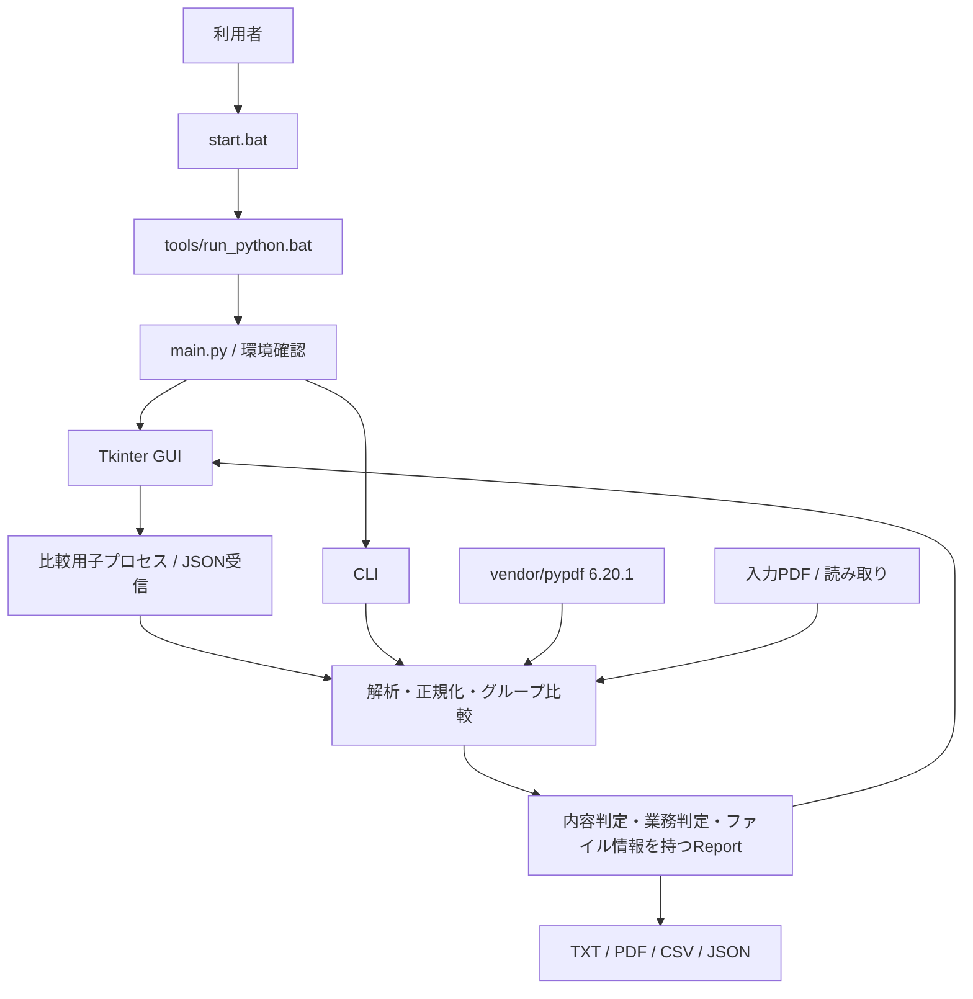
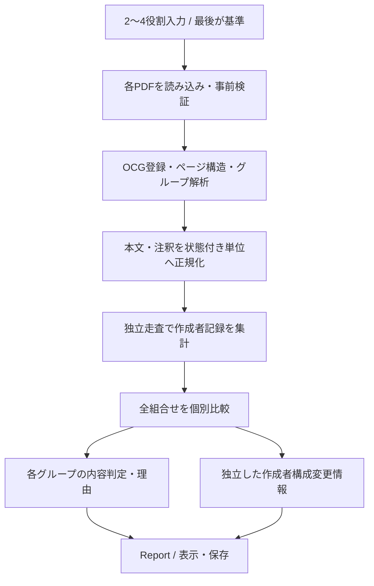
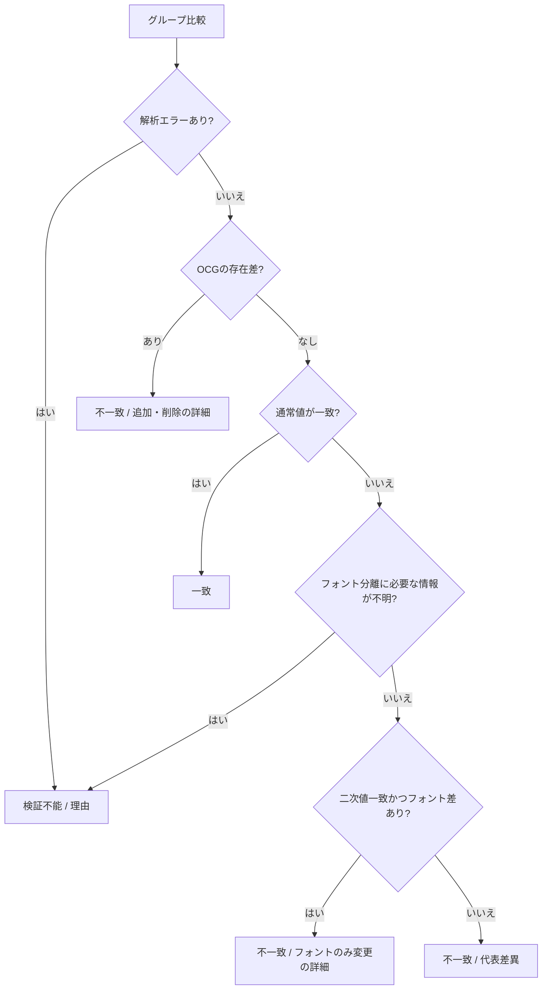

# 基本設計書

対象: diffpdf-layer 0.2.0。基準日: 2026-10-26。

## 1. 位置付け

[要件定義書](software-requirements.md)を、機能構成・処理方式へ展開する。関数・データ構造・上限条件は[詳細設計書](detailed-design.md)、実装の確認範囲は[テスト仕様書](test-specification.md)を参照する。下記BD番号は要件・テストからの参照先である。

## 2. システム構成・実行環境（BD-01）

Windows上の通常インストール済みPythonでソースを実行する。検証済み構成はPython 3.14.8 64bit、Tk 9.0、pypdf 6.20.1である。起動コードはPython 3.14系を許可する。pypdfは手動配置したvendorソースに限定する。比較・TXTには実行時のpip・venv作成・外部通信・外部バイナリは不要である。PDF出力はReportLab等と日本語フォントを追加配置する。

GUIは子プロセスで比較し、親の画面イベント処理を継続する。CLIは同じ比較エンジンを同期実行する。pypdfはPDF解析に使用し、レンダラーやEditorを比較処理から呼び出さない。PDF-XChange Editorは実出力の検証に用いた編集ソフトウェアであり、ツールの起動に必要な依存ではない。

## 3. 入力と画面（BD-02）

入力は担当・確認が必須、審査・承認は任意の2～4PDFである。GUIは4つの役割欄にフルパスを表示し、選択・解除で変更する。基準は指定された最後の工程から自動決定する。入力変更時は旧結果を無効化する。同じパスを複数回追加することは禁止していない。

画面は入力一覧・操作ボタン、進行表示、結果一覧、選択行の読み取り専用詳細欄で構成する。主表はレイヤーを縦軸、役割別PDFを横軸とする。別タブに全組合せのPDF全体・業務判定を表示し、詳細を選択できる。処理中は入力変更と比較開始を無効化し、「中止」を有効にする。進行表示は処理済みページ数や百分率を表さない。

画面上へのPDF表示、注釈編集、結果JSONを開く操作、ドラッグ＆ドロップ専用UIは設けない。詳細な操作は[ユーザーマニュアル](user-manual.md)を参照する。

## 4. グループ分類と比較フロー（BD-03）

| グループ | 主な対象 | 分類方式 |
|---|---|---|
| PDF本体 | ページ数・対応文書属性・用紙領域や回転等のページ属性 | 文書・ページ構造から抽出 |
| レイヤーなし | OCGに属さない本文描画・注釈 | 所属なしが確認できるもの |
| レイヤー: 名前 | 当該OCGの描画・注釈・関連設定 | 登録されたOCG参照を名前へ解決 |

本文の文字が常に「PDF本体」に入るわけではない。OCG未所属の本文は「レイヤーなし」、所属する本文は該当OCGへ分類する。DEMOスタンプとURI Linkも同じ規則で扱い、除外しない。OCG未登録・OCMD・重複名等を単なる所属なしへ置き換えない。

全入力からレイヤー名の和集合を取り、比較組ごとに両方に存在しない名前は通常省く。名前の新規追加・削除を判定し、名前変更は旧名削除と新名追加となる。局所的な差は他グループへ伝播させない。ただし影響範囲不明の解析失敗は複数グループの検証不能となる。

## 5. 順序非依存比較（BD-04）

q/Q、marked content、BT/ET、パスの完結と所属を確認して描画単位を抽出し、その単位で実際に使用する継承状態と資源を結び付ける。同じページ・グループ内の完全な単位を、重複数を保持したマルチセットで比較する。注釈も同じく個数付きで比較する。

順序を無視するのは独立性を確認した単位間である。単位内部の文字順・パス構造・行列適用順は保持する。Form XObjectとAnnotation Appearance（AP）は内部を順序付きで解析した一単位とする。単純なページの状態保存区間は条件付きで複数の完結した子描画へ分割する。生のPDF命令を一括ソートしない。

独立性・所属・状態を確定できない構造を推測で一致にしない。保守的に検証不能とする場合と、安全に解析できる複合単位を内部順序付きのまま比較する場合がある。後者では内部の並べ替えが不一致となりうる。あらゆる等価描画・座標変換の書き換えを正規化する設計ではない。

## 6. 内容判定とフォント判定（BD-05）

通常値は使用フォントの辞書・埋め込みデータを保持する。差があった場合のみ、厳密な文字マッピングから得た文字と非フォント構造による二次値を比較する。文字、明示位置、サイズ、色、透明度等も一致するときだけ不一致とし、詳細に「フォントのみ変更」を記録する。フォント名は内部名・CSS申告名であり、正式名称や字形の認証ではない。

未知Encoding・曖昧CMapは推測しない。ただし通常値そのものが一致する場合、文字復元不能だけを理由にその通常一致を取り消すことはしない。字幅や画素位置をレンダリングして保証する設計ではない。

## 7. 作成者情報（BD-06）

注釈の/Tを内容比較から除き、内容解析が終わった後に別走査する。/Contents・/Subj・独自属性は内容に残す。/M・/CreationDate・/NMの従来の除外は維持する。

レイヤーなし・各OCGについて、PDFごとの名前別件数・未設定件数・取得不能件数・完全性・存在・理由を保持する。欠落/空文字の/Tは未設定、読み取れない値は取得不能とする。内容解析が検証不能でも取得できる作成者情報は保持する。所属不明時は件数を推測せず、影響する集計を未完了とする。

両側の集計が完全な場合だけ、名前別件数と未設定件数の構成差をtrue/falseで記録する。不完全ならnullとする。重複注釈の個別の変更前後を作らない。同じ集計になる個別の名義交換を検出する機能ではない。

「注釈の作成者名（PDF記録値）」として表示し、操作者・最終編集者・本人の証明に用いない。PDF本体は集計対象外である。

## 8. 表示・出力（BD-07）

内容判定は一致・不一致・検証不能の3種類とし、PDF全体の一致状況と業務判定を別々に集約する。合成順序行は設けない。GUIの選択行詳細とTXTは同じ整形処理を使う。CSVはファイル情報・主表・全組合せ・明細の各セクションとする。JSONはschema_version 4でfont_changesと双方のAuthorInfo、authors_changedを構造化する。

TXT/JSONはUTF-8、CSVはUTF-8 BOM付き。JSONの旧version 2・3はライブラリの読み込みで旧補助行を除き、残る判定を再比較が必要な検証不能へ変換する。GUIに保存結果の読み込みボタンはない。形式の詳細は[DD-09](detailed-design.md#dd-09)を参照する。

## 9. 実行制御とエラー処理（BD-08）

GUIは子プロセスのJSONを受け取り、180秒超・異常終了・不正JSONを比較失敗として扱う。中止は子プロセスを停止し、判定結果を残さない。世代番号で中止前の遅延結果を排除する。時間超過では、成功行や各グループの架空の判定行を生成しない。

入力PDFは厳密モードで解析し、暗号化・壊れた参照・未知命令・未対応構造等は理由付きで扱う。所有者が分かれば当該グループ、分からなければ影響しうるグループへ検証不能を付す。作成者だけの解析警告は参考情報の完全性に閉じ込める。CLIにはGUIと同じ180秒制限を設けていない。

## 10. 原本・出力保護と制約（BD-09）

入力はrbで読み込み、メモリー上で解析する。結果保存は入力と同じパス・実ファイルへの上書きを拒否する。CSVセルの数式開始文字をエスケープする。PDFのActionやURIを実行せず、対応URIは値として比較する。

結果はパス、注釈の一部、記録された作成者名を含みうる。保存先は利用者が管理する。完成した出力を一時ファイルへ書き、原子的に置換する。入力以外の既存レポートを上書きから一律保護する機能や暗号化保存は設けない。OSの隔離や強制メモリー上限もない。解析上限と未対応構造は[DD-03](detailed-design.md#dd-03)と[対応構造一覧](supported-structures.md)を参照する。

## 11. 基本設計と要件IDの対応

| 設計 | 対応する要件 |
|---|---|
| BD-01 | NFR-001、NFR-002、NFR-008 |
| BD-02 | FR-001、FR-002、FR-016、FR-017 |
| BD-03 | FR-003～FR-006、FR-015 |
| BD-04 | FR-007～FR-010、NFR-004 |
| BD-05 | FR-011、FR-023、NFR-004 |
| BD-06 | FR-012～FR-014 |
| BD-07 | FR-019～FR-021、FR-024、NFR-009 |
| BD-08 | FR-018、FR-023、NFR-005、NFR-006 |
| BD-09 | FR-022、NFR-003、NFR-005、NFR-007 |
